  

  

    <b>Crafting responsive, clean user experiences & exploring modern software engineering.</b>
  

  

    
    <!-- LinkedIn link: Replace with your actual LinkedIn profile URL once created -->
    
    
  

---

### 💫 About Me

- 🎓 **Education:** Pursuing **B.Tech in Information Technology** at **VESIT (Vivekanand Education Society's Institute of Technology)**, Mumbai.
- 💻 **Tech Focus:** Web Development, Responsive UI/UX, and Modern Frontend Design.
- 🛠️ **DevOps & Tools:** Practicing distributed version control with **Git & GitHub** and collaborative workflows.
- 🌱 **Currently Exploring:** Advanced JavaScript, React, and Full-Stack Architecture.
- 🎯 **Goals:** Building impactful software solutions and contributing to innovative tech projects.
- ⚡ **Fun Fact:** Love turning complex wireframes into pixel-perfect responsive layouts.

---

### 🛠️ Tech Stack & Tools

  
    
  

---

### 📊 GitHub Activity & Stats

  <table border="0">
    <tr>
      <td>
        
      </td>
      <td>
        
      </td>
    </tr>
  </table>

   

  

---

### 📂 Featured Repositories

| Repository | Description | Tech |
| :--- | :--- | :--- |
| 🎮 **[React Nexus](https://github.com/TanmayNileshShinde/react-nexus)** | 8-in-1 cyber arcade web ecosystem featuring real-time cloud leaderboards & 60 FPS physics engines. Co-creator. | `React` `Firebase RTDB` `Tailwind` `Framer Motion` |
| ⚡ **[AnTPDF](https://github.com/TanmayNileshShinde/antpdf)** | Zero-server, 100% in-browser WebAssembly PDF studio with 18+ tools. Co-creator. | `Next.js` `TypeScript` `WASM` `Tailwind` |
| 🎓 **[CollabClass](https://github.com/TanmayNileshShinde/collabnclass)** | Real-time virtual classroom with WebRTC video calling, synchronized canvas & live code execution. Co-creator. | `React` `TypeScript` `WebRTC` `Tailwind` |
| 🌐 **[antaraparab](https://github.com/Antara-Parab/antaraparab)** | Responsive College Web Portal prototype built with pure CSS 12-column grid system & multi-viewport media queries. | `HTML5` `CSS3` `Responsive UI` |
| 🛠️ **[DevOps_Exp5_67_D10A](https://github.com/Antara-Parab/DevOps_Exp5_67_D10A)** | DevOps Lab Practical on Distributed Version Control, branching, and team collaboration with Git & GitHub. | `Git` `GitHub` `DevOps` |

---

  <i>"Passionate about technology, clean code, and continuous learning."</i>

